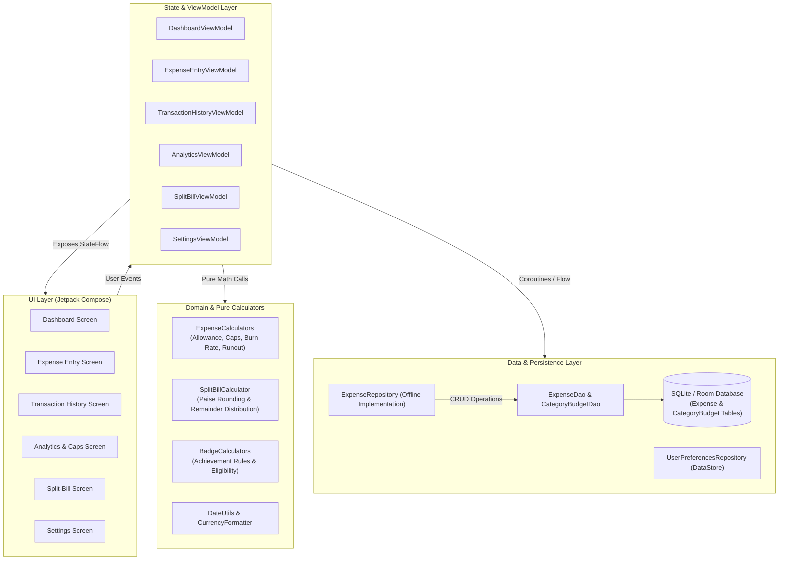

# Campus Expense Tracker 🎓💰

A modern, offline-first Android application designed to help college and university students manage their daily living expenses, monitor monthly budgets, and develop healthy financial habits.

Developed as a capstone project during the **Android Developer Virtual Internship** (B.Tech curriculum).

---

## 📌 Problem Statement

College students living in hostels, PGs, or on campus often receive a fixed monthly allowance from their parents or scholarships. Managing this money is challenging:
* Traditional expense-tracking apps focus merely on recording past transactions, without answering practical forward-looking questions like *"How much can I safely spend today?"*
* Students frequently exhaust their budgets in the first two weeks of the month due to lack of visibility into their spending pace.
* Group dining, canteen bills, and shared project expenses lead to awkward calculations and rounding disputes.
* Many commercial finance applications require active internet connections, cloud accounts, or intrusive banking permissions that college students do not need or want.

**Campus Expense Tracker** addresses these exact challenges with a lightweight, 100% offline, privacy-first mobile tool tailored to campus life.

---

## 🎯 Project Objectives

1. **Intuitive Expense Logging:** Provide a clean Material Design 3 interface to quickly log, categorize, edit, and delete daily campus expenses.
2. **Dynamic Daily Allowance:** Compute and dynamically update a safe daily spending limit based on remaining budget and days left in the current month.
3. **Category Budget Caps:** Enable students to set spending limits on high-spend categories (e.g., Food, Canteen, Books, Entertainment) with live warning alerts at 80% and exceeded alerts at 100%.
4. **Burn Rate & Runout Forecasting:** Calculate historical average daily spending pace to project when the monthly budget will run out if current spending habits continue.
5. **Smart Spending Badges:** Encourage financial discipline through transparent, rule-based milestones (*Thrifty Week*, *Under Budget*, *Budget Champion*).
6. **Split-Bill Calculator:** Split group meal and hostel bills among 2 to 100 people with exact paisa/cent rounding, allowing students to optionally log their personal share directly to their expense history with one tap.
7. **Offline-First & Privacy-Centric:** Store all user data locally on the device using Android Room and Jetpack DataStore with zero network tracking.

---

## ✨ Key Features

| Feature | Description | Business Rules & Logic |
|---|---|---|
| **Expense Management** | Add, edit, and delete expenses with title, amount, category, date, and optional notes. | Validates non-empty title, numeric amount > 0 and ≤ 1,000,000, and valid date. |
| **Transaction History** | Filterable and searchable expense log. | Live search across title, note, and category; filter by category; sort by Newest, Oldest, Highest, or Lowest. |
| **Dynamic Daily Allowance** | Recomputes safe daily allowance in real time. | $\text{Daily Allowance} = \frac{\text{Monthly Budget} - \text{Total Spent}}{\text{Days Remaining}}$. Detects tight budgets (<15% remaining or <5/day), exhausted budgets, and overspending. |
| **Per-Category Budget Caps** | Set custom monthly limits per category. | Evaluates status: `ON_TRACK` (<80%), `WARNING` (80%–100%), and `EXCEEDED` (>100%). Provides live impact warnings while typing in the expense entry screen. |
| **Burn Rate & Runout Forecast** | Estimates budget sustainability based on daily pace. | Daily burn rate = $\frac{\text{Month Spent}}{\text{Days Elapsed}}$. Forecasts estimated runout date and classifies status into `SUSTAINABLE`, `ON_TRACK`, `EARLY_RUNOUT`, `EXHAUSTED`, or `OVER_BUDGET`. |
| **Smart Spending Badges** | Automated financial milestone achievements. | **Thrifty Week:** 7-day spending within weekly cap ($Budget / 4.33$).<br>**Under Budget:** Evaluated after mid-month if pace is sustainable.<br>**Budget Champion:** At least 5 transactions, no exceeded caps, sustainable pace. |
| **Split-Bill Calculator** | Evenly divide shared bills with exact paisa distribution. | Splits total bill among 2–100 participants. Distributes remainder cents one-by-one to ensure $\sum \text{Shares} \equiv \text{Total Amount}$. Optional button to record user's personal share directly to Room. |
| **Currency Selection** | Configurable display currency via Settings. | Defaults to Indian Rupee (**INR ₹**), with option to switch to US Dollar (**USD $**). Persisted across app restarts via Jetpack DataStore. |

---

## 🛠️ Technologies & Tools Used

* **Language:** [Kotlin 2.2](https://kotlinlang.org/) — standard idioms, coroutines, and type-safe flows.
* **UI Framework:** [Jetpack Compose](https://developer.android.com/jetpack/compose) with [Material Design 3](https://m3.material.io/) — declarative UI, state hoisting, scaffold layouts, and edge-to-edge support.
* **Architecture:** Unidirectional Data Flow (UDF) with Android Architecture Components (`ViewModel`, `StateFlow`, `SharingStarted.WhileSubscribed`).
* **Local Persistence:** 
  * [Room Database](https://developer.android.com/training/data-storage/room) — SQLite abstraction for structured expense and category budget entities.
  * [Jetpack Preferences DataStore](https://developer.android.com/topic/libraries/architecture/datastore) — asynchronous key-value storage for user budget and currency settings.
* **Navigation:** [Navigation for Compose](https://developer.android.com/guide/navigation/design/compose) — single-activity architecture with route-based navigation graph.
* **Dependency Management:** Gradle Version Catalog (`gradle/libs.versions.toml`) and Kotlin Symbol Processing ([KSP](https://kotlinlang.org/docs/ksp-overview.html)).
* **Unit Testing:** JUnit 4, AndroidX Test Core/Runner, Kotlinx Coroutines Test, and Robolectric.

---

## 🏗️ System Architecture

The project follows the official Android Architecture Guidelines, separating concerns into UI, Domain/Calculations, and Data layers:



---

## 📂 Source Code Structure

```
app/src/main/java/com/example/
├── CampusExpenseApplication.kt      # Application class initializing dependency container
├── MainActivity.kt                  # Single Activity hosting the Compose NavGraph
│
├── data/                            # Local Data Layer (Room & DataStore)
│   ├── AppContainer.kt              # Manual Dependency Injection container
│   ├── Expense.kt                   # Room Entity for expense transactions
│   ├── ExpenseCategory.kt           # Enum for predefined categories (Food, Books, etc.)
│   ├── ExpenseDao.kt                # Data Access Object for expense queries (Flow-based)
│   ├── ExpenseDatabase.kt           # Room Database class with migration-free schema
│   ├── ExpenseRepository.kt         # Repository interface & offline Room implementation
│   ├── CategoryBudget.kt            # Room Entity for per-category budget limits
│   ├── CategoryBudgetDao.kt         # DAO for category budget caps
│   └── UserPreferencesRepository.kt # Preferences DataStore for monthly budget & currency
│
├── ui/                              # Presentation Layer (Jetpack Compose)
│   ├── AppViewModelProvider.kt      # Factory instantiating ViewModels with repository DI
│   ├── analytics/                   # Analytics screen & Category Breakdown
│   ├── badges/                      # Spending badge models and eligibility calculators
│   ├── components/                  # Reusable UI cards, stat badges, and dialogs
│   ├── dashboard/                   # Dashboard Screen, UiState, and ExpenseCalculators
│   │   ├── DashboardScreen.kt       # Main dashboard layout
│   │   ├── DashboardViewModel.kt    # StateFlow combiner for dashboard UI
│   │   └── ExpenseCalculators.kt    # Pure domain calculation functions (Caps, Runout, Allowance)
│   ├── entry/                       # Add / Edit Expense screen and validator
│   ├── history/                     # Transaction history, search, and sorting
│   ├── navigation/                  # Compose Navigation destinations and NavHost graph
│   ├── settings/                    # Monthly budget and INR/USD currency selector
│   ├── splitbill/                   # Split-Bill Screen, ViewModel, and Calculator
│   └── theme/                       # Material 3 Color scheme, Typography, and Theme
│
└── util/                            # Pure Utilities
    ├── CurrencyFormatter.kt         # Locale-aware currency and percentage formatting
    └── DateUtils.kt                 # Calendar date math, month boundaries, and formatters
```

---

## 💻 Installation & Setup

### Prerequisites
* **Android Studio:** Ladybug (2024.2.1) or later recommended.
* **JDK:** Java Development Kit 17 (bundled with modern Android Studio).
* **Android SDK:** Compile SDK 36, Minimum SDK 24 (compatible with Android 7.0 Nougat and above).

### Steps
1. **Clone or Download the Project:**
   ```bash
   git clone <repository-url>
   cd campus-expense-tracker
   ```
2. **Open in Android Studio:**
   - Launch Android Studio.
   - Select **File > Open...** and choose the `campus-expense-tracker` folder.
3. **Gradle Sync:**
   - Wait for Gradle to download dependencies and sync the project automatically.
4. **Run the App:**
   - Select an Android Virtual Device (AVD) running Android 8.0+ or connect a physical Android device via USB debugging.
   - Click the green **Run (▶)** button or press `Shift + F10`.

---

## 🧪 Testing Summary

The project includes an automated unit test suite verifying all critical business rules, Room database operations, validation constraints, and calculation algorithms:

```powershell
# Run all unit tests from the command line:
.\gradlew.bat testDebugUnitTest

# Clean and rebuild debug APK:
.\gradlew.bat clean testDebugUnitTest assembleDebug
```

### Automated Test Results (81 Passing Tests, 0 Failures):
* **`ExpenseCalculationTest` (55 tests):**
  - Daily allowance under normal, tight, exhausted, zero-day, and overspent budgets.
  - Category budget cap evaluations (`ON_TRACK`, `WARNING` at 80%, `EXCEEDED` at 100%, and unbudgeted).
  - Category live impact messages and threshold formatting.
  - Daily burn rate and historical average daily spending rate.
  - Budget runout forecast for insufficient history, over budget, exhausted, and early runout conditions.
  - Smart spending badge evaluation (*Thrifty Week*, *Under Budget*, *Budget Champion*) with edge cases.
* **`SplitBillCalculationTest` (12 tests):**
  - Input validations (blank, non-numeric, zero, negative, participant limits 2–100, max amount).
  - Even bill division among participants.
  - Uneven bill division with exact penny/paisa remainder distribution ($\sum \text{Shares} \equiv \text{Total}$).
  - Primary user share extraction and custom participant names.
* **`ExpenseRoomDatabaseTest` (8 tests):**
  - In-memory Room database insertion, update, retrieval by ID, and deletion.
  - Category budget insertion, update-on-conflict, and deletion.
  - Date-range filtering for monthly queries.
* **`ExpenseValidationTest` (4 tests):**
  - Title presence, valid numeric positive amount, and upper amount bounds.
* **`ExampleRobolectricTest` & `ExampleUnitTest` (2 tests):**
  - Robolectric Android context integration and JVM unit baseline.

> **Note on Verification:** Automated test suites and Gradle debug APK compilation passed with 100% success (81/81 tests passing). Physical on-device UI testing was not performed during verification because no hardware device or active emulator was attached to the build environment.

---

## 📱 Application Screenshots

*(Screenshots can be captured directly from your Android Studio emulator or physical device and placed in `docs/screenshots/`)*

| Dashboard & Allowance | Category Caps & Alerts | Split-Bill Calculator |
|:---:|:---:|:---:|
| *(Add Dashboard screenshot)* | *(Add Category Caps screenshot)* | *(Add Split-Bill screenshot)* |

| Transaction History | Analytics & Breakdown | Settings & Currency |
|:---:|:---:|:---:|
| *(Add History screenshot)* | *(Add Analytics screenshot)* | *(Add Settings screenshot)* |

---

## ⚠️ Current Limitations

1. **Offline Only:** Data is stored locally on the user's device; there is no cloud backup or multi-device synchronization.
2. **Standard Calendar Month:** Budget cycles run from the 1st day of the month to the last day of the month; custom salary/allowance cycles (e.g., 5th to 4th) are not yet supported.
3. **Manual Entry:** Expenses must be entered manually by the student; automated SMS reading and receipt scanning (OCR) are not implemented.

---

## 🚀 Future Enhancements

* **Custom Billing Cycles:** Allow students to set their monthly budget reset date according to when they receive their monthly allowance.
* **CSV / PDF Export:** Export transaction history for college record-keeping or personal archiving.
* **Receipt Image Attachments:** Attach photos of canteen or bookstore bills to individual transactions.
* **Recurring Fixed Expenses:** Auto-log recurring monthly obligations like room rent or mess subscriptions.

---

## 🎓 Academic & Internship Context

This application was developed as part of the **B.Tech Android Developer Virtual Internship**, demonstrating competencies taught in the official **Android Basics with Compose** curriculum:
* **Unit 1 & 2:** Kotlin fundamentals, Compose layout composables, state hoisting, and reactive UI updates.
* **Unit 3 & 4:** Architecture components (`ViewModel`, `StateFlow`, UDF pattern), Material 3 styling, and Jetpack Navigation.
* **Unit 5 & 6:** Coroutines, Flow, SQLite persistence with Room Database, and Preferences DataStore.
* **Unit 7 & 8:** Automated unit testing, code modularization, and Git version control practices.

---

## 📄 License

This project is developed for educational and academic portfolio purposes.
